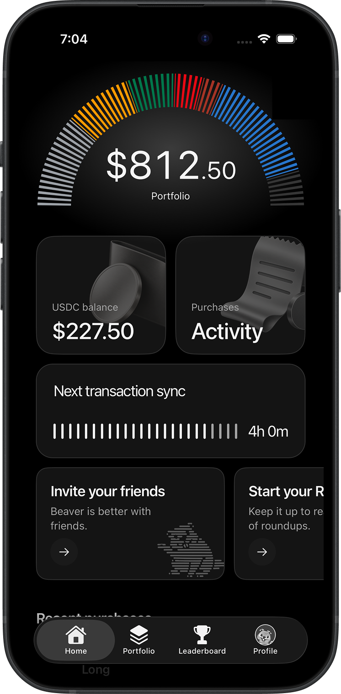
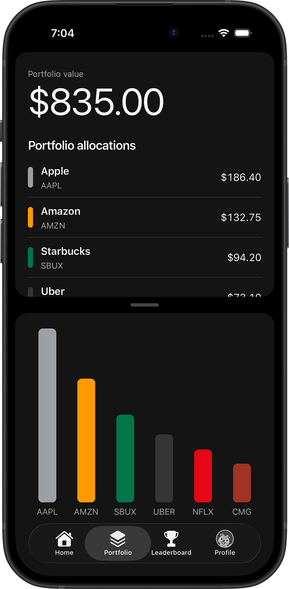
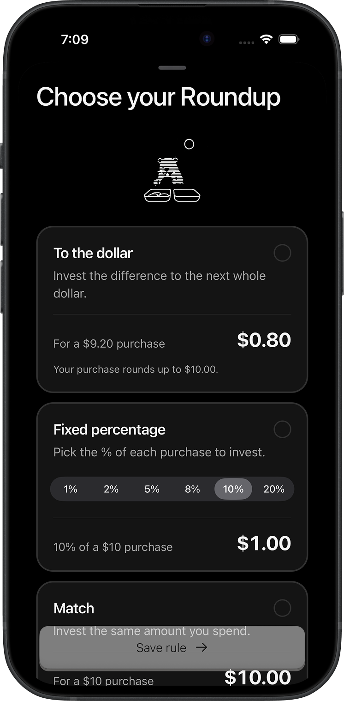
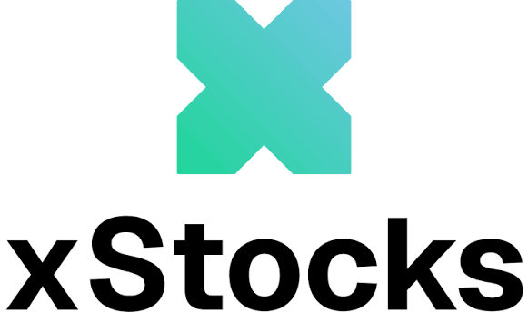
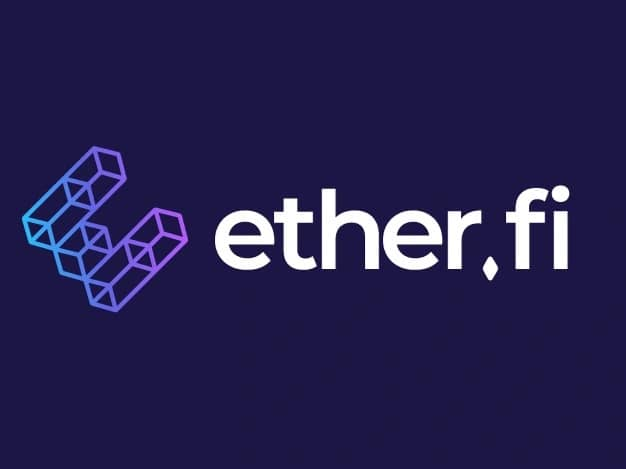

<div align="center">


**built by [0xfreddy](https://x.com/freddy_0x)**

# Beaver

**Turn everyday purchases into stock investments.**

iOS · Android · Solana Mobile

[](https://github.com/0xfreddy/beaver/actions/workflows/ci.yml)
[](LICENSE)
[](CONTRIBUTING.md)
[](https://expo.dev)

<!-- App Store URL still pending at launch -->
<a href="#-try-it"></a>
<a href="https://testflight.apple.com/join/u2B71KkZ"></a>

[**Download Android / Solana Mobile APK — v0.1.0 (5)**](https://expo.dev/artifacts/eas/1lfS_YpHgz2rYTNXXd-5h2nKz3jiF_nLfeq-b3XRS70.apk)

Beaver rounds up your everyday card purchases and invests the spare change
into fractional stock — [xStocks](https://xstocks.fi) and
[prestocks.io](https://prestocks.io) — automatically, settled on-chain.

</div>

---

<p align="center">
  
  
  
</p>

**TL;DR:** connect any bank — 1,400+ institutions supported — or a crypto card
([ether.fi](https://ether.fi), [Tuyo](https://www.tuyo.com)). Beaver detects
your purchases, rounds up the spare change, and gets you stock — every roundup
is routed on-chain through [Jupiter](https://jup.ag).

## 🔌 Integrations

| Logo | Integration | What Beaver uses it for |
| :--- | :--- | :--- |
| 🏦 | **Banking connection** | Link any bank from 1,400+ supported institutions — purchases are detected automatically. |
| <a href="https://xstocks.fi"></a> | **[xStocks](https://xstocks.fi)** | Tokenized public stocks, each backed 1:1 by a real share — the fractional stock your roundups buy. |
| <a href="https://prestocks.io"></a> | **[PreStocks](https://prestocks.io)** | Tokenized pre-IPO shares of private companies. |
| <a href="https://ether.fi"></a> | **[ether.fi](https://ether.fi)** | Crypto card — connect it as a roundup source and cash withdrawals out to it. |
| <a href="https://www.tuyo.com"></a> | **[Tuyo](https://www.tuyo.com)** | Self-custodial USDC card — spend on it and Beaver rounds up the change. |
| <a href="https://jup.ag"></a> | **[Jupiter](https://jup.ag)** | On-chain swap routing — each roundup executes as a USDC → xStocks swap. |

## 📱 Try it

| Release channel | Version | Description | Link |
| :--- | :--- | :--- | :--- |
| App Store | — | Public listing pending. | 🚧 coming soon |
| TestFlight | latest | Public beta — newest features, may contain bugs. | [Join the beta](https://testflight.apple.com/join/u2B71KkZ) |
| Android / Solana Mobile | v0.1.0 (5) | Signed standalone live APK; no Metro required. | [Download APK](https://expo.dev/artifacts/eas/1lfS_YpHgz2rYTNXXd-5h2nKz3jiF_nLfeq-b3XRS70.apk) |
| **Run locally** | — | **The full app in mock mode** — no keys, no backend. | [Build it yourself ↓](#-build-it-yourself) |

The Android APK also targets Solana Mobile devices with an MWA-compatible wallet.
It uses **live mainnet accounts**, not the sample account. Sign-in requires the
hosted service. Wallet deposit/withdrawal acceptance on a physical device and
dApp Store publication remain pending; see [release status](docs/releases/2026-10-12.md).
The APK uses `com.beaver.app` and replaces the existing Android variant when signed
with the same certificate. [Install and judging guide](docs/solana-mobile.md).

## ✨ What it does

- 💳 **Roundups** — connect a card, and every purchase rounds up into your portfolio
- 📈 **Fractional stock** — spare change flows into tokenized stocks and pre-IPO shares (xStocks, PreStocks), settled on-chain
- 👥 **Social** — invite friends with codes, climb leaderboards, keep your identity to an alias
- 💸 **Withdrawals** — review a destination and approve with device biometrics; Android adds wallet ownership verification through Mobile Wallet Adapter, subject to account-service availability
- 🤖 **Android** — native navigation and back behavior, repaired animations and sheets, adaptive launcher icon, and biometric unlock
- ☀️ **Solana Mobile** — approve USDC deposits from an MWA-compatible wallet into your existing Privy account wallet; iOS/web retain address and QR funding
- 🌗 **Native feel** — Liquid Glass on iOS 26, dark mode, haptics, and an offline mock account

[Latest client fixes and release notes](docs/releases/2026-10-12.md).

## 🔓 What's open, what's not

This repository contains Beaver's **iOS, Android, and Solana Mobile client**. The account service it
talks to — roundup decisions, bank sync, execution, withdrawals — is a
separate, closed-source backend. That means everything here builds and runs
**with zero API keys and zero backend** against the built-in mock engine, and
the private investment engine never ships in this repo. The public Android
client does include user-approved wallet deposit construction and signing via
MWA; automated investment execution remains server-side. Details and diagrams:
[docs/architecture.md](docs/architecture.md).

## 🔨 Build it yourself

**Prerequisites:** Node ≥ 22.13, pnpm 11 (`corepack enable`), and Xcode or
Android Studio for native builds. Web runs with nothing but Node.

```sh
git clone https://github.com/0xfreddy/beaver.git
cd beaver
pnpm install
cp apps/mobile/.env.example apps/mobile/.env
pnpm --filter @roundups/mobile android  # builds and installs the Android dev client
# Or: pnpm --filter @roundups/mobile ios (macOS + Xcode)
pnpm dev:mobile        # reconnect the installed dev client; w = web preview
```

Once it's running you can:

1. Browse a full sample account — purchases, roundups, portfolio, performance
2. Connect and disconnect the mock bank link
3. Tune your roundup rules and watch the math update
4. Invite friends, rename your alias, and climb the leaderboard
5. Preview funding and withdrawals locally (simulated; no on-chain transaction)

You need **zero API keys** for all of the above. Live sign-in and real data
require Privy and API credentials we can't share, so design changes to work in
mock mode.

#### Use your own API tokens

Good news: **you don't need any.** The app runs fully in mock mode out of the
box — that is the default development experience. If you want live sign-in or
telemetry, these are the knobs:

| Name | Service | Url | Comments |
| :--- | :--- | :--- | :--- |
| `EXPO_PUBLIC_PRIVY_APP_ID` / `EXPO_PUBLIC_PRIVY_CLIENT_ID` | Privy auth | <https://privy.io> | Only for live sign-in. Mock mode needs none. |
| `EXPO_PUBLIC_API_URL` | Account service | — | Mock mode intercepts it; defaults to `http://localhost:3000`. |
| `EXPO_PUBLIC_SOLANA_NETWORK` | Solana cluster | <https://solana.com> | `devnet` by default; production builds pin `mainnet`. |
| `EXPO_PUBLIC_SOLANA_RPC_URL` | Solana RPC | — | Optional client-safe HTTPS endpoint for Android wallet deposits. |
| `EXPO_PUBLIC_SENTRY_DSN` | Sentry | <https://sentry.io> | Optional. |
| `EXPO_PUBLIC_POSTHOG_KEY` | PostHog analytics | <https://posthog.com> | Optional. We never track PII. |
| `EXPO_PUBLIC_EAS_PROJECT_ID` | Your own EAS project | <https://expo.dev> | Optional — only for OTA updates on a fork. |

Full reference: [docs/build.md](docs/build.md).

## 🧱 Architecture

Expo (SDK 57) + React Native, TypeScript strict throughout, three workspaces:
the app (`apps/mobile`), the shared contracts (`packages/types`), and the pure
roundup math (`packages/domain`). The closed service sits behind an HTTPS API
validated by those shared contracts. Map and data flow:
[docs/architecture.md](docs/architecture.md).

## 🔬 Tests

Unit tests run on [Vitest](https://vitest.dev) — check out the `*.test.ts`
files colocated with the source. Coverage is strongest in the roundup math and
the mobile data layer; selected component/provider regressions and Android wallet
flows are also covered. Physical-device end-to-end acceptance remains separate. We hold merged code to `pnpm check` and prefer a
small test that explains *why* it exists. Guide: [docs/testing.md](docs/testing.md).

## 🙋 Contribute

If you find a bug, or if you have an idea for Beaver, please
[file an issue](https://github.com/0xfreddy/beaver/issues) — we really appreciate
feedback and input! For code contributions, start with
[CONTRIBUTING.md](CONTRIBUTING.md): setup, code style, and the PR checklist
(including per-platform QA). For vulnerabilities, follow [SECURITY.md](SECURITY.md)
instead of opening a public issue.

## 📰 License

The client code is [MIT licensed](LICENSE). The Beaver name, logo, and
illustration assets are **not** covered by MIT — fork the code, replace the
branding. Fonts ([Faculty Glyphic](https://fonts.google.com/specimen/Faculty+Glyphic),
Inter) are under the SIL Open Font License — see
`apps/mobile/assets/licenses/`.

## ⭐ Credits

Built with [Expo](https://expo.dev). UI inspiration from
[reacticx](https://github.com/rit3zh/reacticx). Made with ❤️ by the Beaver
team and [contributors](https://github.com/0xfreddy/beaver/graphs/contributors) —
PRs welcome!
